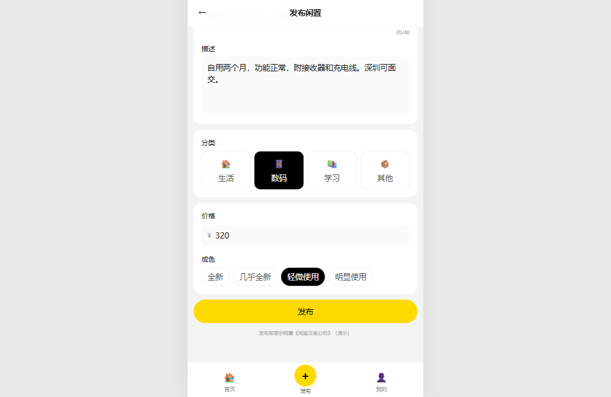

# 闲置换换 · 二手交易平台前端

一个可以直接跑起来的最小可用版本（MVP），参考闲鱼的信息架构：**浏览购买 → 商品详情 → 发布出售 → 我的**。

技术栈：React 19 + Vite 7 + TypeScript + Tailwind CSS 4 + React Router 7。

## 启动

```bash
cd secondhand-market
npm install
npm run dev
```

打开 http://localhost:5173

生产构建：

```bash
npm run build
npm run preview
```

> 如果 npm 的全局缓存在沙箱外不可写，用 `npm install --cache .npm-cache`。
> 如果 `vite` 因沙箱禁止 esbuild 子进程而报 `spawn EPERM`，在本地终端直接运行即可；也可以用 `node serve.mjs` 预览已构建的 `dist/`（带 SPA fallback）。

## 预览

| 首页（购买流） | 商品详情 |
| --- | --- |
|  |  |

| 发布（出售流） | 我的 |
| --- | --- |
|  |  |

## 页面

| 路由 | 页面 | 说明 |
| --- | --- | --- |
| `/` | 首页（购买流） | 搜索、分类筛选（全部 / 生活 / 数码 / 学习 / 其他）、双列商品流 |
| `/item/:id` | 商品详情 | 图片、价格、描述、成色、分类、卖家、我想要 |
| `/publish` | 发布（出售流） | 选图（本地压缩到 900px）、标题、描述、分类、价格、成色 |
| `/mine` | 我的 | 我发布的商品、删除、统计 |

底部导航：首页 / 发布 / 我的。详情页隐藏底部导航，改为底部购买操作栏。

## 目录结构

```
src/
├── api/
│   ├── index.ts        # 前后端唯一契约层（接口定义 + 导出 itemApi）
│   └── mock.ts         # localStorage 的 mock 实现
├── components/         # Layout / BottomNav / ItemCard / CategoryTabs / Toast
├── data/seed.ts        # 12 条演示商品
├── pages/              # Home / ItemDetail / Publish / Mine
├── store/ItemsContext.tsx  # 全局商品状态
├── types.ts            # 类型 + 分类/成色常量
├── utils.ts            # 时间、价格格式化
├── App.tsx
├── main.tsx
└── index.css           # Tailwind 入口 + 主题色
```

## 给后端同学的接口契约

所有页面只依赖 `src/api/index.ts` 里的 `ItemApi` 接口，**页面代码不直接碰数据源**。

```ts
interface ItemApi {
  list(query?: { category?: Category | 'all'; q?: string }): Promise<Item[]>
  get(id: string): Promise<Item | undefined>
  create(input: CreateItemInput): Promise<Item>
  remove(id: string): Promise<void>
  like(id: string): Promise<Item | undefined>
}
```

建议对应的 REST 接口：

| 方法 | 路径 | 用途 |
| --- | --- | --- |
| GET | `/api/items?category=digital&q=ipad` | 列表 / 搜索 |
| GET | `/api/items/:id` | 详情 |
| POST | `/api/items` | 发布 |
| DELETE | `/api/items/:id` | 删除 |
| POST | `/api/items/:id/like` | 我想要 +1 |

### 数据结构

```ts
type Category = 'life' | 'digital' | 'study' | 'other'
type Condition = 'new' | 'like-new' | 'good' | 'fair'

interface Item {
  id: string
  title: string
  description: string
  price: number            // 元，最多两位小数
  category: Category       // 生活 / 数码 / 学习 / 其他
  condition: Condition     // 全新 / 几乎全新 / 轻微使用 / 明显使用
  images: string[]         // 图片 URL 数组；MVP 里是 data URL
  cover: string            // 无图时的封面表情占位
  seller: string
  sellerAvatar: string
  likes: number            // 想要人数
  createdAt: number        // 毫秒时间戳
}
```

发布请求体（`CreateItemInput`）：

```json
{
  "title": "iPad Air 4 64G 深空灰",
  "description": "自用机，屏幕无划痕",
  "price": 1650,
  "category": "digital",
  "condition": "good",
  "images": [],
  "cover": "📱"
}
```

### 接真实后端的方式

1. 在 `src/api/index.ts` 里加一个 `httpApi`，用 `fetch` 实现上面 5 个方法；
2. 把文件末尾的 `export const itemApi: ItemApi = mockApi` 改成 `httpApi`；
3. 图片上传目前是前端压缩成 data URL，接后端时改成先调上传接口拿 URL，再放进 `images`。

## 当前数据说明

- 首次打开会写入 12 条 seed 商品，存在 `localStorage` 的 `secondhand.items.v1` 键里。
- 发布的商品同样写这个键，刷新不丢。
- 想重置数据：浏览器控制台执行 `localStorage.removeItem('secondhand.items.v1')` 后刷新。

## 已实现 / 未实现

已实现：分类浏览、搜索、详情、发布（含多图上传与压缩）、删除、想要 +1、空状态、加载态、错误态、移动端适配。

未实现（下一步）：登录/注册、图片上传到服务端、聊天/私信、订单与支付、收藏、卖家主页、分页/上拉加载、举报与风控、SEO。

## 关于“逆向参考”

本项目的布局与交互参考了闲鱼的公开页面结构（分类 tab、双列卡片流、详情页底部操作栏、发布表单），代码和视觉均为自己实现，没有复制对方源码或素材，方便后续维护和交接。
