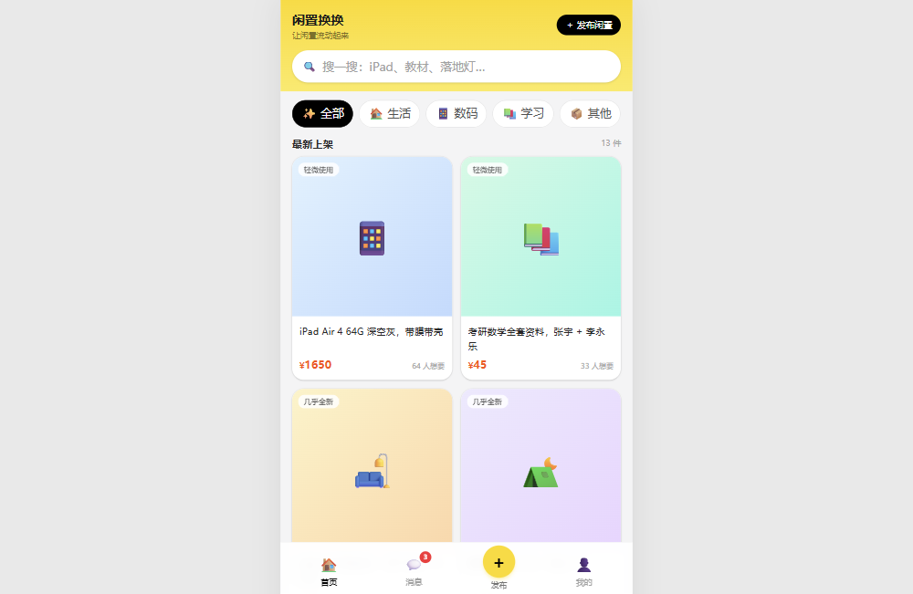
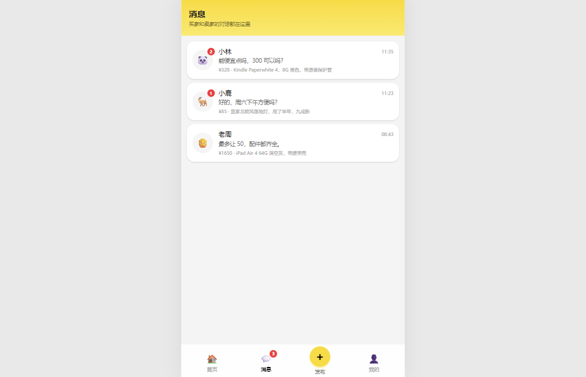
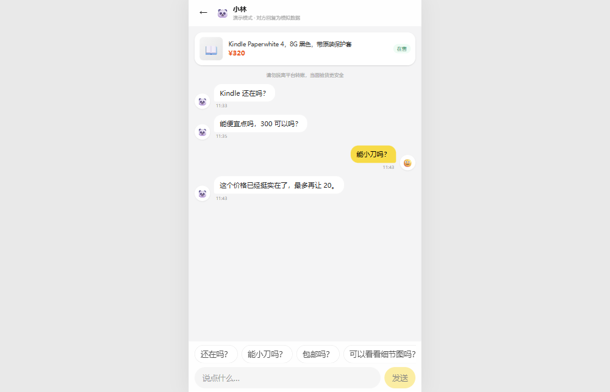
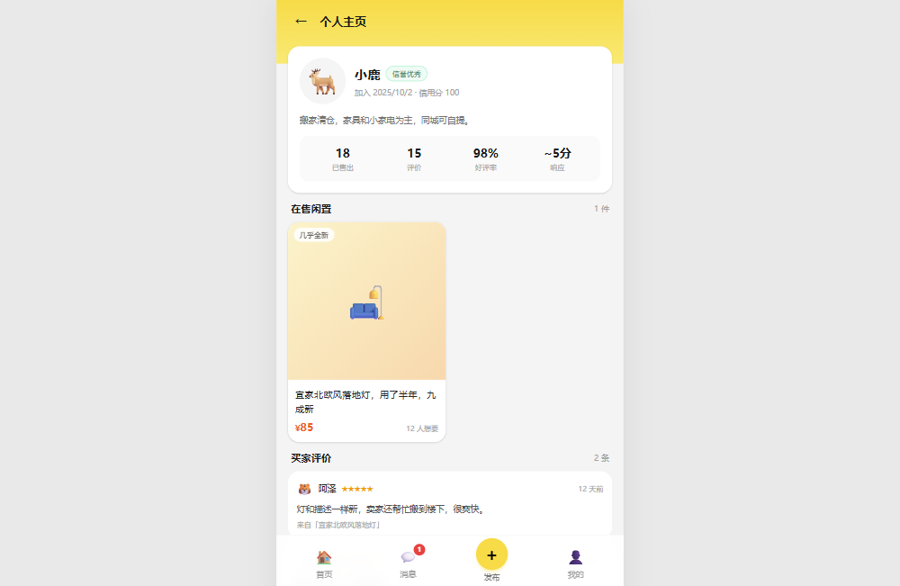
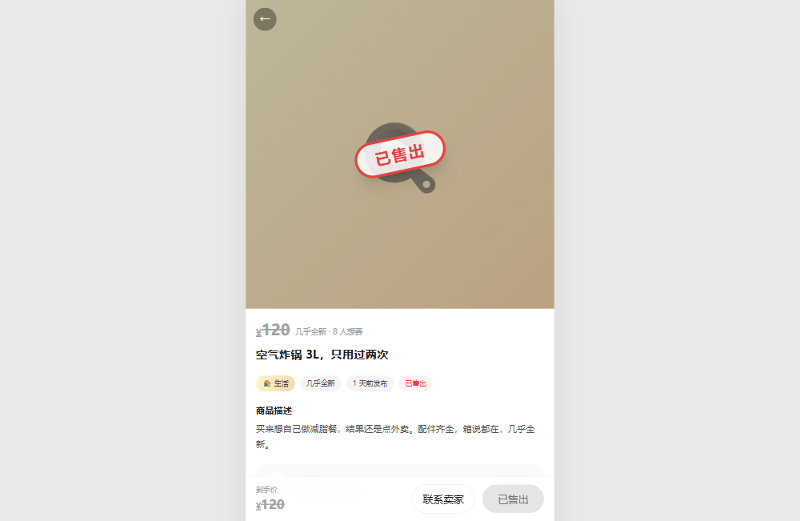
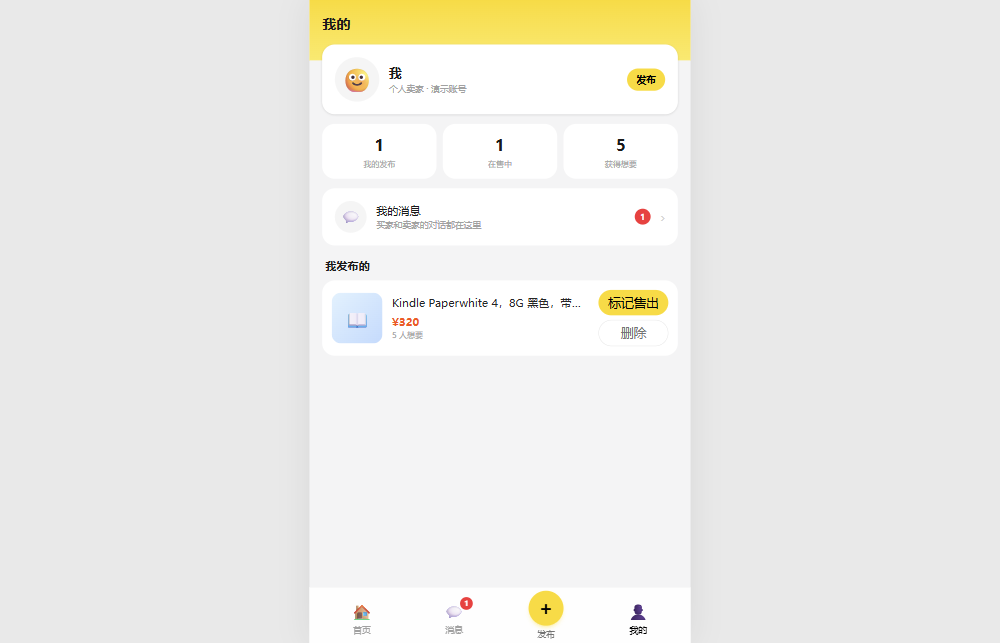

# 闲置换换 · 二手交易平台前端

一个可以直接跑起来的最小可用版本（MVP），参考闲鱼的信息架构：**浏览购买 → 商品详情 → 联系卖家 → 发布出售 → 个人主页**。

技术栈：React 19 + Vite 7 + TypeScript + Tailwind CSS 4 + React Router 7。

## 启动

```bash
cd secondhand-market
npm install
npm run dev
```

打开 http://localhost:5173

### Windows 一键预览（构建版，不需要 npm run dev）

- 双击项目根目录的 `打开预览.cmd`：会自动检查 `dist/`、启动本地服务并打开浏览器。
- 或者在 Windows 终端里执行：

```bat
cd secondhand-market
node serve.mjs --open
```

`npm run preview:open` 效果相同。默认端口 4173，端口被占用时可以用 `set PORT=4174` 换一个。停止服务按 `Ctrl+C`。

生产构建：

```bash
npm run build
npm run preview
```

> 如果 npm 的全局缓存在沙箱外不可写，用 `npm install --cache .npm-cache`。
> 如果 `vite` 因沙箱禁止 esbuild 子进程而报 `spawn EPERM`，在本地终端直接运行即可；也可以用 `node serve.mjs` 预览已构建的 `dist/`（带 SPA fallback）。

## 页面

| 路由 | 页面 | 说明 |
| --- | --- | --- |
| `/` | 首页（购买流） | 搜索、分类筛选（全部 / 生活 / 数码 / 学习 / 其他）、双列商品流、已售出盖章 |
| `/item/:id` | 商品详情 | 图片、价格、描述、成色、分类、卖家信用、联系方式、联系卖家 |
| `/messages` | 消息列表 | 买家和卖家的全部会话，未读红点 |
| `/chat/:id` | 聊天页 | 完整对话、商品上下文卡片、快捷话术、发送消息 |
| `/user/:id` | 个人主页 | 信用等级、交易统计、在售商品、买家评价 |
| `/publish` | 发布（出售流） | 选图（本地压缩到 900px）、标题、描述、分类、价格、成色、可选联系方式 |
| `/mine` | 我的 | 我发布的商品、标记售出 / 重新上架、删除、消息入口 |

底部导航：首页 / 消息 / 发布 / 我的。商品详情页和聊天页隐藏导航，改为自己的底部操作栏。

## 预览

| 首页 | 消息列表 |
| --- | --- |
|  |  |

| 聊天页 | 个人主页 |
| --- | --- |
|  |  |

| 商品详情（已售出） | 我的 |
| --- | --- |
|  |  |

## 目录结构

```
src/
├── api/
│   ├── index.ts        # 前后端唯一契约层（ItemApi / ChatApi / SellerApi）
│   └── mock.ts         # localStorage 的 mock 实现
├── components/         # Layout / BottomNav / ItemCard / CategoryTabs / Toast
├── data/
│   ├── seed.ts         # 13 件演示商品（含 2 件已售出、1 件“我”发布的）
│   ├── sellers.ts      # 13 个卖家资料 + 15 条买家评价
│   └── chat.ts         # 3 条演示会话
├── pages/              # Home / ItemDetail / Messages / Chat / UserProfile / Publish / Mine
├── store/ItemsContext.tsx  # 全局商品状态
├── types.ts            # 类型、分类/成色常量、信用等级计算
├── utils.ts            # 时间、价格格式化
├── App.tsx
├── main.tsx
└── index.css           # Tailwind 入口 + 主题色
```

## 给后端同学的接口契约

所有页面只依赖 `src/api/index.ts` 里的三个接口，**页面代码不直接碰数据源**。

```ts
interface ItemApi {
  list(query?: { category?: Category | 'all'; q?: string }): Promise<Item[]>
  get(id: string): Promise<Item | undefined>
  create(input: CreateItemInput): Promise<Item>
  remove(id: string): Promise<void>
  like(id: string): Promise<Item | undefined>
  updateStatus(id: string, status: 'available' | 'sold'): Promise<Item | undefined>
}

interface ChatApi {
  conversations(): Promise<Conversation[]>
  messages(conversationId: string): Promise<Message[]>
  ensure(itemId: string): Promise<Conversation>      // 点“联系卖家”时拿到或创建会话
  send(conversationId: string, text: string): Promise<Message>
  markRead(conversationId: string): Promise<void>
  unreadCount(): Promise<number>
  simulateReply(conversationId: string): Promise<Message | undefined>  // 仅演示用，接后端后删掉
}

interface SellerApi {
  get(id: string): Promise<SellerProfile | undefined>
  reviews(sellerId: string): Promise<Review[]>
}
```

建议对应的 REST 接口：

| 方法 | 路径 | 用途 |
| --- | --- | --- |
| GET | `/api/items?category=digital&q=ipad` | 列表 / 搜索 |
| GET | `/api/items/:id` | 详情 |
| POST | `/api/items` | 发布 |
| DELETE | `/api/items/:id` | 删除 |
| POST | `/api/items/:id/like` | 我想要 +1 |
| PATCH | `/api/items/:id/status` | 标记售出 / 重新上架（body: `{ status }`） |
| GET | `/api/conversations` | 会话列表（带未读数） |
| GET | `/api/conversations/:id/messages` | 会话消息 |
| POST | `/api/conversations` | 创建会话（body: `{ itemId }`） |
| POST | `/api/conversations/:id/messages` | 发送消息（body: `{ text }`） |
| POST | `/api/conversations/:id/read` | 清空未读 |
| GET | `/api/users/:id` | 卖家资料与统计 |
| GET | `/api/users/:id/reviews` | 卖家收到的评价 |

### 数据结构

```ts
type Category = 'life' | 'digital' | 'study' | 'other'
type Condition = 'new' | 'like-new' | 'good' | 'fair'
type ItemStatus = 'available' | 'sold'

interface Item {
  id: string
  title: string
  description: string
  price: number            // 元，最多两位小数
  category: Category       // 生活 / 数码 / 学习 / 其他
  condition: Condition     // 全新 / 几乎全新 / 轻微使用 / 明显使用
  images: string[]         // 图片 URL 数组；MVP 里是 data URL
  cover: string            // 无图时的封面表情占位
  seller: string
  sellerId: string
  sellerAvatar: string
  likes: number            // 想要人数
  status: ItemStatus       // available 在售 / sold 已售出
  contact?: string         // 发布时可选填的外部联系方式
  createdAt: number        // 毫秒时间戳
}

interface SellerProfile {
  id: string
  name: string
  avatar: string
  bio: string
  joinedAt: number
  stats: {
    soldCount: number        // 售出量
    reviewCount: number      // 收到的评价数
    goodRate: number         // 好评率 0-1
    avgRating: number        // 平均评分 1-5
    responseMinutes: number  // 平均响应时间
  }
  isMe?: boolean
}

interface Review { /* 买家对卖家的返评：itemId、fromName、rating、content、createdAt */ }
interface Conversation { /* itemId、buyerId、sellerId、双方名称头像、unread、updatedAt */ }
interface Message { /* conversationId、fromId、text、createdAt */ }
```

### 信用等级规则

信用等级完全由系统根据交易数据自动计算，不需要人工认证：

```
信用分 = 55 + min(售出量, 40) × 0.6 + (有评价时：好评率 × 20 + 平均评分 × 3)
```

| 等级 | 条件 |
| --- | --- |
| 金牌卖家 | 信用分 ≥ 92 且售出 ≥ 30 单 |
| 信誉优秀 | 信用分 ≥ 80 |
| 信誉良好 | 信用分 ≥ 70 |
| 新人 | 其余 |

### 接真实后端的方式

1. 在 `src/api/index.ts` 里加一个 http 实现，按三个接口的签名逐个实现；
2. 把文件末尾的三个导出从 mock 换成 http 实现；
3. 删除 `simulateReply` 的调用（`src/pages/Chat.tsx`），换成真实的 WebSocket / 轮询收消息；
4. 图片上传目前是前端压缩成 data URL，接后端时改成先调上传接口拿 URL，再放进 `images`。

## 当前数据说明

- 商品存在 `localStorage` 的 `secondhand.items.v2`，会话在 `secondhand.conversations.v1`，消息在 `secondhand.messages.v1`。
- 首次打开会写入 13 件 seed 商品、3 条演示会话和对应消息。
- 想重置数据：浏览器控制台执行 `localStorage.clear()` 后刷新。

### 演示模式

聊天页发送消息后，会等约 0.9 秒模拟对方自动回复（按关键词匹配价格、包邮、交易方式等话术）。页面顶部有「演示模式」标注，接真实后端后删掉 `simulateReply` 即可。

## 已实现 / 未实现

已实现：分类浏览、搜索、商品详情、发布（多图 + 压缩 + 可选联系方式）、删除、想要 +1、标记售出 / 重新上架、已售出盖章、站内私信（会话列表 / 聊天页 / 快捷话术 / 未读红点）、个人主页（信用等级 / 统计 / 在售 / 评价）、空状态、加载态、错误态、移动端适配。

未实现（下一步）：登录注册、图片上传到服务端、真实即时通讯（WebSocket）、订单与支付、收藏、举报拉黑、分页/上拉加载、卖家主页编辑、评价提交入口。

## 关于“逆向参考”

本项目的布局与交互参考了闲鱼的公开页面结构（分类 tab、双列卡片流、详情页底部操作栏、发布表单、已售出盖章），代码和视觉均为自己实现，没有复制对方源码或素材，方便后续维护和交接。
